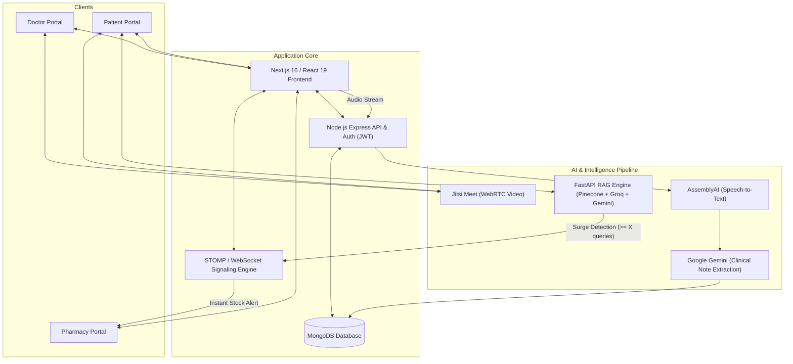

# Project Technical Architecture & Technology Stack
## Smart Telehealth, Clinical AI Scribe, Multilingual Assistant & Regional Pharmacy Alert System

---

## 1. System Overview

This project is an integrated telemedicine and clinical intelligence platform designed to streamline remote consultations, automate clinical documentation, provide patient-facing multilingual AI assistance, and proactively balance regional pharmacy supplies through real-time demand alerts.

---

## 2. Decided Technical Architecture by Feature

### Feature 1: Doctor-to-Patient Live Video Call & Signaling
* **Video Calling Engine:** **Jitsi Meet API (WebRTC)** for end-to-end encrypted, low-latency audio/video consultation rooms without requiring custom media servers.
* **Signaling Protocol:** **STOMP over WebSockets** (`@stomp/stompjs` on client, Node.js `ws` on backend) for instantaneous call invitation, ringing notifications, and doctor availability tracking.
* **Dual-Track Audio Capture:** Browser **Web Audio API** (`AudioContext`) mixing the doctor's microphone with the patient's incoming WebRTC audio track into a unified stream recorded via **MediaRecorder API** (`audio/webm` / `audio/wav`).

### Feature 2: Automated Video Call Summarization & Clinical Extraction
* **Speech-to-Text (STT):** **AssemblyAI REST API** (`speech_model: 'best'`, automatic language detection) to transcribe conversational doctor-patient dialogue.
* **Clinical Entity Extraction:** **Google Gemini** (`gemini-2.5-flash`, temperature `0.1`) configured with a strict JSON schema prompt to extract:
  * Symptoms & Diagnosis
  * Prescription (Drug name, dosage, frequency)
  * Vitals (BP, Pulse, SpO2, Temperature)
  * Lifestyle Advice, Recommended Tests & Follow-up Plan
* **Consultation Triaging:** **LangChain** structured severity classification categorizing cases (`Low`, `Medium`, `High`, `Critical`).

### Feature 3: Automated Prescription & Clinical Note Generation
* **Document Compilation:** **`jspdf`** for fast client-side PDF rendering of structured clinical summaries and official prescriptions.
* **Clinical Formatting:** Standardized regex sanitization and dosage parsers to structure medicine tables and patient vitals into print-ready documentation.
* **Record Storage:** **MongoDB** schema storage paired with UUID-based document management for lab reports and historical notes.

### Feature 4: Multilingual Medical AI Chatbot
* **Architecture:** Retrieval-Augmented Generation (RAG) hosted as a high-performance **FastAPI** service.
* **Vector Knowledge Base:** **Pinecone** vector database with medical literature indexed using **HuggingFace Embeddings** (`intfloat/e5-base-v2`).
* **Multilingual Translation Layer:** **Groq LLaMA** (`llama-3.1-8b-instant`) to auto-detect language/script (English, Romanized Hindi/Urdu, Romanized Kannada, or native scripts) and translate vernacular queries into clinical English for retrieval.
* **Contextual Response Generation:** **Google Gemini** / **Groq LLaMA 3.3 70B** generating conversational replies in the user's native script or conversational Hinglish/Kanglish with mandatory clinical disclaimers.

### Feature 5: Regional Pharmacy Early Alert System
* **Surge Detection Engine:** The chatbot pipeline tags incoming queries with clinical entities and the user's regional pincode.
* **Threshold Trigger:** MongoDB aggregation monitors query frequency. When queries for a given condition (e.g., Dengue, Flu, Viral Fever) exceed threshold **$X$** in a specific region within a 24-hour window, an alert event fires.
* **Real-Time Notification:**
  * **WebSocket Push:** Broadcasts immediate stock surge alerts over STOMP to `/topic/pharmacy/alerts/{region}` directly updating the pharmacist dashboard.
  * **Email Dispatch:** **Resend API** transmits automated supply advisories to registered regional pharmacies indicating essential medicines to stock (e.g., Paracetamol, ORS, Antihistamines).

---

## 3. Technology Stack Summary

| Layer | Selected Tool / Technology | Purpose |
| :--- | :--- | :--- |
| **Frontend** | **Next.js 16 (App Router) + React 19** | Core responsive web application & role-based portals |
| **Styling & UI** | **Tailwind CSS + Lucide React** | Medical UI components and responsive styling |
| **Video Infrastructure** | **Jitsi Meet API (WebRTC)** | Embedded secure video consultations |
| **Realtime Signaling** | **STOMP over WebSocket (`ws` + `@stomp/stompjs`)** | Call alerts, doctor availability, and instant pharmacy notifications |
| **Backend Runtime** | **Node.js + Express** | REST API gateway, authentication, and file processing |
| **Authentication** | **JWT + Resend OTP** | Secure authentication for Patients, Doctors, and Pharmacists |
| **Database** | **MongoDB + Mongoose** | Storage for user records, consultation summaries, and query logs |
| **Speech-to-Text** | **AssemblyAI** | Accurate medical consultation audio transcription |
| **Clinical Extraction** | **Google Gemini (GenAI)** | Structured JSON medical note and prescription parsing |
| **AI Backend** | **FastAPI + Uvicorn** | Dedicated microservice for chatbot and ML pipelines |
| **Vector Database** | **Pinecone** | Semantic medical knowledge retrieval |
| **LLM & Embeddings** | **Groq LLaMA 3.1/3.3 + Gemini + HuggingFace** | Fast multilingual detection, reasoning, and localized responses |
| **PDF Generation** | **jsPDF** | Instant in-browser prescription and medical record downloads |
